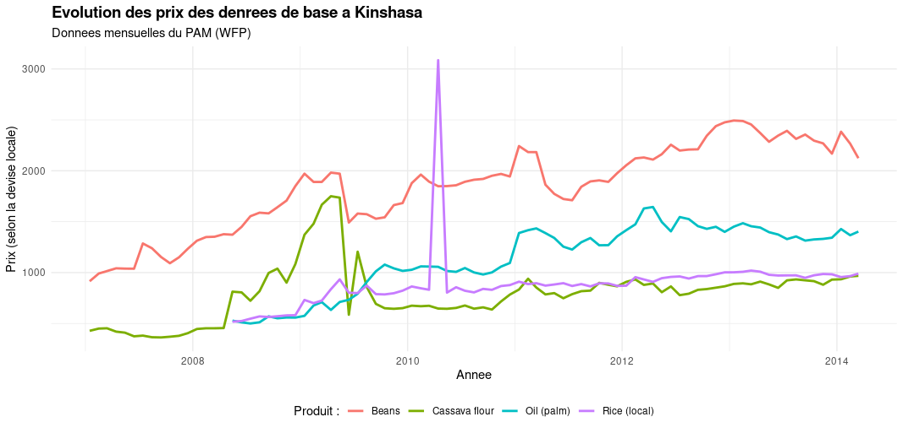
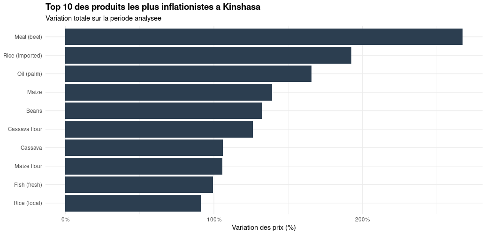

# Analyse des prix alimentaires en RDC (Kinshasa)

## Contexte
Ce projet analyse l'evolution des prix des denrees alimentaires de base a Kinshasa. Dans un contexte de volatilite economique, comprendre quels produits subissent la plus forte inflation est crucial pour les menages et les organisations humanitaires.

## Données
- **Source** : [Humanitarian Data Exchange (HDX) - WFP Food Prices](https://data.humdata.org/dataset/wfp-food-prices-for-democratic-republic-of-the-congo)
- **Période** : 2007 à aujourd'hui
- **Filtre** : Ville de Kinshasa (`admin1 == "Kinshasa"`)

## 🛠️ Outils utilisés
- **R** (tidyverse, dplyr, lubridate, ggplot2, scales)
- **RStudio** & **GitHub**

## Résultats clés
1. **Évolution des prix** : Le graphique montre une tendance haussière sur le long terme, avec des pics marqués sur certains produits de base.
2. **Top Inflation** : Le produit ayant subi la plus forte variation est la viande de boeuf [meat (beef)], avec une augmentation de +250%.

## Visualisations

### Évolution des prix dans le temps

### Top 10 des produits les plus inflationnistes

## 🚀 Comment exécuter ce projet
1. Cloner ce dépôt.
2. Ouvrir le fichier `drc_food_prices_r.Rproj` dans RStudio.
3. Exécuter le script `01_nettoyage.R` pour préparer les données.
4. Exécuter le script `02_analyse.R` pour générer les graphiques.

## Automatisation
Ce projet integre un workflow **GitHub Actions** (`.github/workflows/mise_a_jour.yml`).
Chaque Semaine, le script `03_mise_a_jour.R` est exécuté automatiquement sur Les serveurs de GitHub pour télécharger (si nécessaire) la dernière version du dataset depuis HDX. Si des changements sont détectés, un commit est automatiquement généré.  
